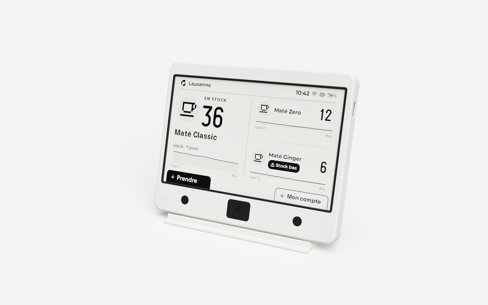
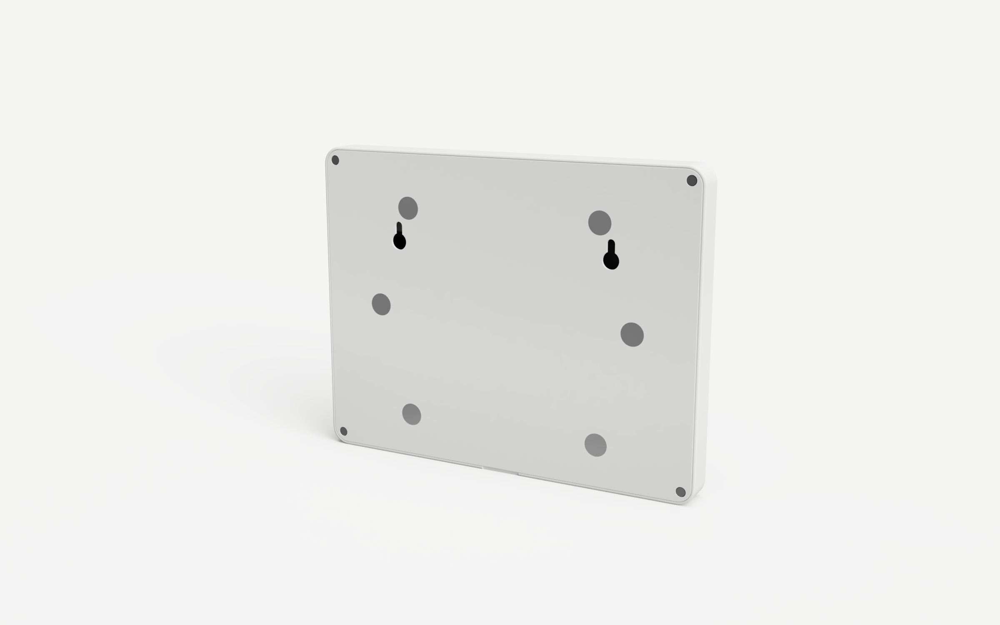

# Boîtier du terminal

Rendus Fusion du modèle en lancer de rayons, l'écran d'accueil de l'OS en décalque
(`apps/mate/__snapshots__/stock.png`).

Le modèle vit dans Fusion. La source de vérité est le script
`boitier_matecrew/boitier_matecrew.py` : il crée un document neuf avec toutes les cotes en
paramètres utilisateur, et chaque esquisse est cotée par ces paramètres. Changer une valeur
dans Modifier > Modifier les paramètres met le modèle à jour ; pour la garder, la reporter
dans `PARAMS` en tête du script.

Fichiers exportés : un STL par pièce, déjà orienté pour l'impression, `boitier-matecrew.step`
(pièces imprimées et maquettes) et `boitier-matecrew.f3d`. Le document complet (modèles des
cartes et écran compris) est enregistré dans Fusion : « boitier-matecrew », projet « Default
Project ». Les modèles 3D des cartes sont dans
`modeles/` (voir `modeles/LICENCES.md`).

Boîtier : 177,4 × 138,6 × 15,2 mm. La bande sous l'écran ne fait que 23,8 mm : le PN532 monte
sous la dalle, au-dessus du pavé NFC.

## Pièces et impression

Tranché avec OrcaSlicer 2.4.2, profil Wanhao D12 230 (plateau 230 × 230), YUMI PLA, couches
de 0,20, 4 périmètres pour les pièces structurelles, remplissage 10 %, sans support.

| Fichier | Rôle | Sur le plateau | Couleur | Temps | PLA |
|---|---|---|---|---|---|
| `facade.stl` | Coque, fenêtre, touches, zone badge, passage USB-C | Face avant | Blanc | 2 h 34 | 29 g |
| `capot.stl` | Dos : vis, aimants du frigo, trous de serrure | Face extérieure | Blanc | 2 h 09 | 36 g |
| `socle.stl` | Support de bureau incliné à 15°, semelle de 90 mm | Semelle | Blanc | 2 h 46 | 50 g |
| `chassis.stl` | Plaque la dalle, tient la carte driver et la batterie | Face avant | Au choix (caché) | 1 h 16 | 19 g |
| `cadre.stl`, `pastille-gauche.stl`, `pastille-droite.stl`, `pavé-nfc.stl` | Pièces noires de la face | Collerette dessous, face visible en haut | Noir | 0 h 19 | 3 g |
| `facade-monobloc.stl` | Variante : façade d'une pièce et d'une couleur, zones gravées ; remplace `facade.stl` et les pièces noires | Face avant | Une couleur | 2 h 46 | 33 g |

Total : environ 9 h 05 et 138 g. Les pièces noires gagnent à être imprimées avec le lissage
(ironing) des surfaces supérieures, puisque leur face visible est la dernière couche.

4 périmètres : la paroi autour des inserts (1,7 mm) est alors pleine, pas en remplissage.

Variante monobloc : la façade n'est percée que pour l'écran (fenêtre au bord de la zone affichée,
la dalle s'appuie directement sur la face intérieure) et la micro-grille du buzzer. Les zones sont
gravées en traits de 0,8 mm sur 0,4 de profondeur : un anneau de 8 mm par touche, le contour du
pavé et l'icône NFC. Face contre le plateau, chaque trait s'imprime en pont court. Les touches
capacitives et le lecteur NFC travaillent à travers les 1,6 mm de la façade. Elle se construit
avec `MONOBLOC = True` en tête du script.

Plus vite : le temps part surtout dans les parois de la façade (70 %, paroi extérieure à
30 mm/s) et dans les plaques pleines du capot et du socle. Avec paroi extérieure à 45 mm/s,
intérieures à 80, remplissage plein à 120 et 3 périmètres, on gagne encore environ 1 h 20 pour
le même plastique. Des couches de 0,28 iraient plus vite encore, mais les logements de 0,6 mm
(collerettes, pastilles) ne tomberaient plus juste.

### Contrôle d'imprimabilité

Chaque STL a été tranché couche par couche (pas de 0,2 mm) dans son sens d'impression :

- aucune partie volante (zone d'une couche qui ne repose sur rien) ;
- aucun surplomb au-delà de 45°, sauf des ponts tenus aux deux bouts : fonds des logements
  d'aimants du capot (Ø 10,1), haut du passage USB-C (8,5 mm) ;
- porte-à-faux courts : lèvres des touches (0,6), de la batterie (0,8), pattes de la carte
  driver (2,2).

Règles suivies, pour garder le modèle imprimable si on le modifie :

- Face posée sur le plateau plane, ses arêtes en chanfrein à 45° (jamais de congé en bas).
- Ce qui pend dans la façade (plots d'angle des vis du capot) est porté par un gousset à 45°
  accroché aux deux parois.
- Parois d'au moins deux passes de buse (0,8 mm et plus).
- Ajustements : 0,15 à 0,3 mm de jeu pour ce qui glisse, logements serrés pour ce qui
  s'emmanche (buzzer), à reprendre selon l'imprimante.

## Visserie et aimants (commande Bastelgarage)

| Pièce | Dans la commande | Utilisées | Où |
|---|---|---|---|
| Vis M2 × 5 inox, tête cylindrique Ø 3,8 × 1,6, Torx TX6 | 10 | 5 | PN532 (1), capot (4) |
| Inserts laiton M2 × 3, Ø 3,6 | 100 | 5 | Trous de 3,2 × 4 mm (le fabricant demande 3,5 au moins) |
| Aimants néodyme 10 × 1,6 | 8 | 8 | Capot (6), socle (2) : aucun de rechange |

Chaque vis traverse 1,4 à 1,6 mm de pièce puis prend toute la longueur de l'insert (3 mm) ;
son bout finit dans le trou, sans toucher le fond. Les têtes du capot sont 0,2 mm sous le dos,
qui reste plat contre le frigo.

Il faut un tournevis Torx T6, qui n'était pas dans la commande.

## Fixations

- Dalle : centrée par les nervures de la façade, plaquée par le châssis. La façade est
  dégagée devant le haut du verre, où sont collées la puce et la nappe.
- Cadre, pastilles et pavé NFC : posés par l'arrière dans leurs logements, tenus par la dalle,
  les modules tactiles et leurs collerettes.
- PN532 : face plate vers l'avant à 4,5 mm de la façade, tourné d'un quart de tour, barrette
  I2C coudée en haut (ses Dupont montent derrière la dalle). Son trou du bas prend une vis ; celui
  du haut, sous la dalle, s'enfile sur un pion du châssis, et une colonne du capot l'appuie.
- Touches TTP223 : glissées depuis le centre dans des rails ; les lèvres plaquent la zone
  tactile contre la façade, centrée sous la pastille.
- Buzzer Ø 16 × 4 : dans le coin bas gauche, emmanché dans sa bague (`BUZ_FIT`), câble dans
  l'encoche.
- Châssis : trois languettes dans la paroi du haut ; en bas, quatre colonnes du capot le
  plaquent, avec la dalle, contre la façade. Pas de vis.
- Carte driver et XIAO : sur le dos de la dalle, tenus par quatre pattes du châssis. Au-dessus
  de la rangée de broches du haut, 15 mm de place (`PIN_ROOM`) pour souder les fils et les couder. Le bord
  gauche de la découpe encaisse la fiche qu'on enfonce, la butée contre la paroi droite celle
  qu'on retire.
- Batterie : cage du châssis, deux lèvres sur les grands côtés ; les fils sortent à droite.
- Capot : 4 vis aux coins, dans les plots de la façade. Ses colonnes plaquent le bas du châssis
  et le haut du PN532 ; il porte aussi, à 0,1 mm de jeu, sur les parois de la cage de la
  batterie : il reste raide malgré ses 1,2 mm.

## Montage

1. Façade face avant sur la table. Inserts au fer à souder, à la température d'impression
   plus 10 à 20 °C, jusqu'à affleurer : le plot du PN532 et les 4 plots d'angle.
2. Cadre, pastilles et pavé NFC dans leurs logements, par l'arrière.
3. Buzzer dans sa bague, touches dans leurs rails, PN532 vissé par son trou du bas.
4. Dalle dans ses nervures, nappe en haut.
5. XIAO soudé sur ses barrettes mâles, sur la carte driver. Couper à ras les broches et les
   fils qui dépassent côté dalle : la carte est plaquée contre le verre. Nappe branchée, prise
   USB-C dans le passage de la paroi droite.
6. Batterie dans la cage, châssis accroché en haut par ses languettes, son pion dans le trou
   du haut du PN532. Il ne tient pas seul : garder la façade à plat jusqu'au capot.
7. Aimants à la cyanoacrylate : les 6 du capot à fleur du dos. Pour ceux du socle, poser
   chacun sur un aimant du bas du capot : la face qui touche le capot va au fond du logement,
   contre la peau du dossier.
8. Capot, 4 vis serrées au doigt (vers 0,05 N·m) : plus fort, la tête écrase le PLA.

## Tenue (calculs à la main)

Fusion Simulation n'est pas dans la licence Personal : ce sont des ordres de grandeur. Appareil
d'environ 225 g (2,2 N).

| Cas | Résultat |
|---|---|
| Frigo, 6 aimants (vers 0,45 kg chacun sur une porte, frottement 0,3) | 7,9 N en glissement pour 2,2 N : marge de 3,6 |
| Vis du capot quand il pend au frigo | 0,6 N de cisaillement et 0,1 N d'arrachement par vis |
| Serrage d'une vis à 0,05 N·m | 125 N, 18 MPa sous la tête (le PLA cède vers 50 MPa) |
| Tête de vis arrachée à travers 1,4 mm de PLA | vers 420 N |
| Fiche USB-C retirée (20 N au plus) | la butée touche la paroi après 0,2 mm, la paroi encaisse |
| Aimant collé arraché de son logement | colle vers 240 N, aimant 4 à 10 N |
| Peau de 0,8 mm devant un aimant du socle | 1,9 MPa |
| Socle, poussée sur une touche | bascule en arrière vers 9 N (2,2 N avec l'ancienne semelle de 55 mm) |
| Socle sur un bureau lisse | glisse vers 1 N ; vers 3 N avec des patins en caoutchouc (pas dans la commande) |

## Régénérer le modèle

Avec Fusion ouvert, son serveur MCP (`claude mcp add --scope user --transport http fusion
http://127.0.0.1:27182/mcp`) permet à Claude Code de lancer le script et de contrôler le
résultat. À la main : Utilitaires > Scripts et compléments > `+` > dossier
`boitier_matecrew`, puis Exécuter (`build()`).

Par le serveur MCP, un appel ne doit pas dépasser son délai : `setup()` (ou `setup(reuse=True)`
pour reconstruire dans le document enregistré et garder ses versions), puis
`build_parts(["facade", "cadre", "chassis"])`, `build_parts(["capot", "socle", "composants", "ecran"])`,
`export(dossier)`, `build_parts(["modeles"])` (l'import des STEP dure deux minutes environ) et
enfin `check_design()`.

Rendu : `pose_on_stand()` pose le boîtier sur son socle (ou `pose_upright()` debout, pour le
dos), `render(fichier)` lance un rendu local en lancer de rayons (éclairage Photobooth, fond
uni, ombre au sol) ; `pose_on_stand(False)` le remet en place.
L'écran est le composant `ecran`, construit par `build_parts(["ecran"])`.

`check_design()` renvoie les erreurs de la timeline, les esquisses pas entièrement
contraintes, les pièces en plusieurs morceaux et les interférences entre les pièces, les
maquettes et les modèles réels des cartes.

## À vérifier sur les pièces reçues

- `TT_PCB` : épaisseur du circuit des TTP223 (1 mm mesuré), qui règle le serrage des lèvres.
- `PN_T` : épaisseur du circuit du PN532 (1,6 supposé). Entre 1,2 et 2 mm, le bout de la vis
  reste dans le trou de l'insert ; plus fin, il touche le fond.
